> **Action Library LIS Fork** — a fork of [Action Library](https://github.com/CGstuff/Action-Library) by CGstuff (based on 1.6.2), with fixes and workflow additions. See [FORK_CHANGES.md](FORK_CHANGES.md). GPL v3, like the original.

## AI assistance disclosure

The changes in this fork (see [FORK_CHANGES.md](FORK_CHANGES.md)) were written with the help of
Claude (Anthropic), an AI assistant, working on the maintainer's instructions.
Every change was reviewed and tested by the maintainer in a real library before
being committed. AI-assisted commits are marked with a
`Co-Authored-By: Claude` trailer. The original Action Library code by CGstuff
is unchanged except where noted.

  <a href="https://github.com/CGstuff/Action-Library/blob/main/README.md">
    <h1>Original README by CGStuff and installation guide</h1>
  </a>

  

  <h1>LIS Fork</h1>

This fork builds on the original Action Library with a number of improvements focused on managing large animation collections, streamlining everyday navigation through thousands of separate actions, and making the interface more flexible.

---

## Library & Folder Navigation

Managing large libraries is easier with improved folder navigation and organization.

- **Unfiled animations on Home:** The Home view now displays only animations that haven't been assigned to a folder. It is also selected automatically on startup. Home is now meant to be a temporary place before being assigned to a folder.
- **Improved folder selection:** Fixed an issue where selecting a nested folder could jump to another folder with the same name elsewhere in the tree.
- **Move to Folder:** move animations directly between folders using a folder picker with full paths and filtering.

  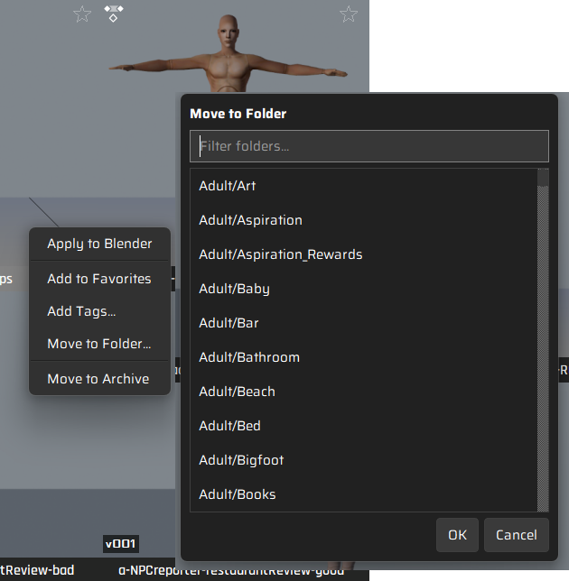

- **Keyboard folder navigation:** Browse folders using keyboard shortcuts, including when the folder tree is hidden.
- **Quick folder access:** The current folder is displayed in the header, and clicking it opens the folder picker.

  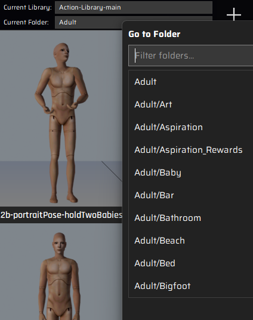

---

## Bulk Editing & Context Menus

Several actions now support multi-selection, making it easier to manage large numbers of animations at once.

- **Bulk context menu actions:** Archive, delete, remove from folder, manage tags, and toggle favorites for multiple selected animations.
- **Bulk status changes:** Change the status of all selected animations at once.
- **Improved folder management:** Moving animations to another folder also removes them from their previous folder.

---

## Keyboard Shortcuts

A dedicated shortcut configuration page provides extensive control over keyboard navigation and common actions.

- **Configurable shortcuts:** Assign shortcuts to actions such as archive, delete, folder management, tags, favorites, renaming, status changes, previews, sorting, and more.
- **Alternative bindings:** Every supported action can have a primary and an alternative shortcut.
- **Mouse wheel bindings:** Use the mouse wheel for supported actions, including changing card size with Ctrl + Wheel by default.
- **Layout-independent keys:** Character shortcuts work according to their physical QWERTY key positions, regardless of the active keyboard layout.
- **Shortcut help overlay:** Quickly view the current keyboard bindings directly in the application.

  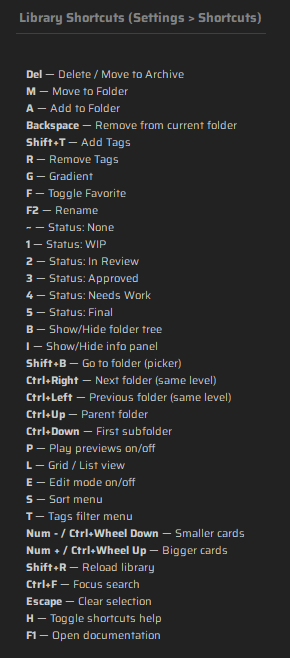

---

## Animation Previews

Preview playback has been expanded with additional playback controls and display improvements.

- **Playback presets (FS1–FS4):** Choose between four frame-skip presets to adjust preview playback speed and smoothness.

  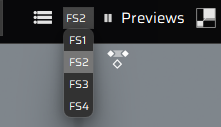

- **Custom playback settings:** Configure each preset in Appearance settings. FS1 preserves the original playback pace.

  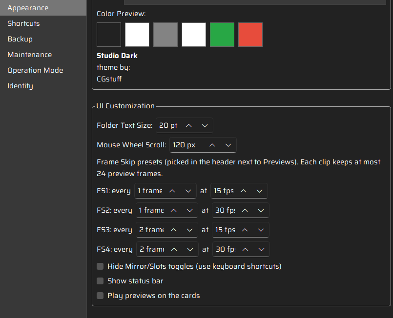

- **Immediate playback:** Enabling previews starts playback immediately instead of waiting for the first scroll.
- **Playback state indicator:** The Previews button now displays a play or pause icon to indicate its current state.

  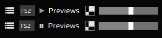

- **Resizable video preview:** The video preview now follows the size of the information panel instead of remaining locked to its initial dimensions.

  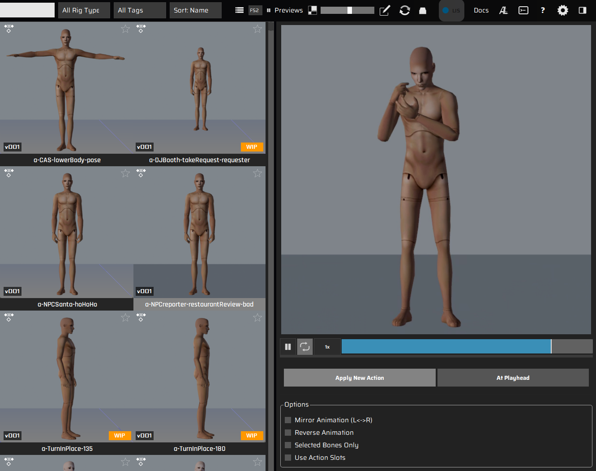

---

## Interface & Customization

The interface has received several usability improvements and additional customization options.

- **Resizable panels:** Show or hide the folder tree and information panel using header buttons or the B / I shortcuts. Panel visibility and widths are preserved between sessions.

  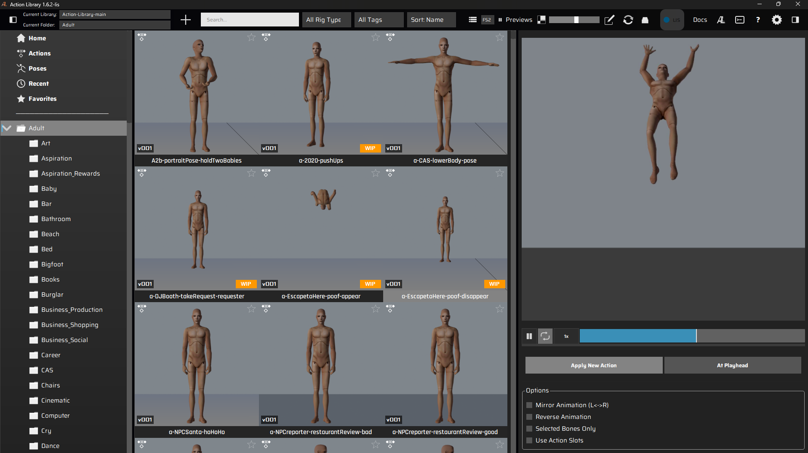

  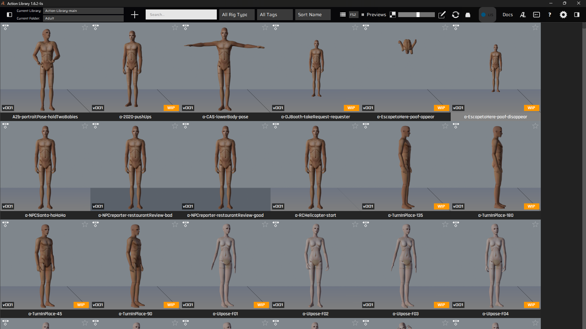

- **Responsive header:** The header adapts to available space, prioritizing the library and current folder information.
- **Larger animation cards:** Maximum card size increased from 300 to 475 pixels, with thumbnails loaded at the larger size to remain sharp.

  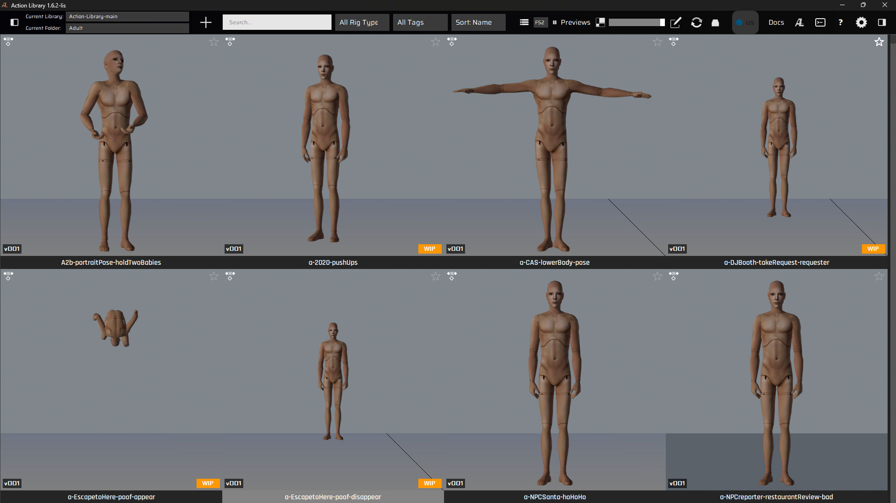

- **Mouse wheel scrolling:** Configure the amount of scrolling performed with each mouse wheel notch.

  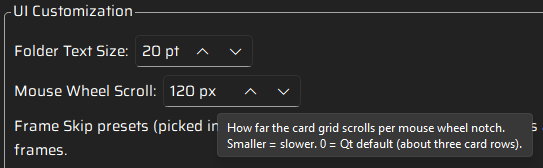

- **Status bar visibility:** Show or hide the status bar. Errors are displayed in a dialog when the status bar is hidden.
- **Improved settings window:** Settings pages scroll when necessary, and the window adapts to the available screen space.
- **Improved settings controls:** Numeric input fields have been widened for better readability.
- **Default animation status:** Newly added animations now start with no status assigned instead of WIP.

---

## Windows Compatibility & Maintenance

A few additional fixes improve reliability and compatibility, particularly on Windows.

- **Preview file handling:** Fixed an issue where open preview videos could prevent animations from being deleted or archived, leaving behind orphaned video files.
- **Independent taskbar entry:** When launched from source on Windows, the application now uses its own taskbar entry and icon instead of Python's.
- **Version identification:** The fork uses its own version identifier (`1.6.2-lis`) and checks for updates against its own releases rather than the upstream repository.
- **Existing installation compatibility:** Existing settings and user data locations remain unchanged, allowing the fork to use an existing Action Library setup.

---

For a detailed technical list of changes and affected files, see [FORK_CHANGES.md](FORK_CHANGES.md).